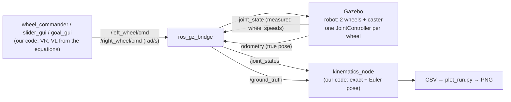
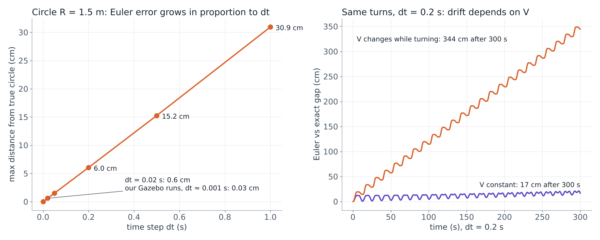

# Differential Drive Kinematics in ROS 2 + Gazebo

Group assignment for **EL6010 Robotics and Autonomous Systems** (ITB, 2026).
Authors: Zahrah Fauziah · *[Choukri]*

We wrote the kinematic equations of a differential drive robot ourselves, drove **each wheel separately** in
Gazebo (no diff-drive plugin), computed the pose from the **measured** wheel speeds, and compared it with
Gazebo's **true pose**. Four variations test different parts of the same equation chain.

```
VR, VL  ──►  V, ω  ──►  ICC, R  ──►  pose (x, y, θ)
```

---

## Results at a glance

All runs: robot with wheel separation **L = 0.5 m** and wheel radius **r = 0.1 m**; Gazebo values are relative
to the pose where each run started.

| Variation | Test | Theory | Our odometry | Gazebo (true) |
|---|---|---|---|---|
| V1 straight (R = ∞) | VR = VL = 0.5 m/s, 6 s | x = 3.000 m | 3.001 m | 2.990 m (gap 1.2 cm, same in 3 runs) |
| V1 spin (R = 0) | VR = 0.3, VL = −0.3 m/s, 5.24 s | x, y unchanged | 0.000, 0.000 | 1.0 cm away, turned 2.2° further |
| V1 turn | VR = 0.6, VL = 0.4 m/s, one lap | R = 1.250 m | 1.250 m | R = 1.230 m |
| V2 inverse kinematics | R = 2 m, V = 0.7 m/s → VR = 0.7875, VL = 0.6125 | R = 2.000 m | 2.000 m | R = 1.980 m |
| V4 exact vs Euler | same wheel data, dt ≈ 0.001 s | — | exact and Euler agree within ~0.03 cm | — |
| V5 goal point | click a goal, plan, GO (open loop) | goal reached | — | arrived 2.8–5.6 cm from the goal in most runs |

**Main finding:** the equations match Gazebo within a few centimetres. The remaining gaps are systematic and
physical (a ~2 cm shift of the turning centre and slip when wheel speeds jump), not numerical.

---

## 1. Kinematic model

Notation: `VR`, `VL` = linear speed of the right / left wheel [m/s]; `L` = wheel separation [m];
`r` = wheel radius [m]; pose `(x, y, θ)`; `ω > 0` = turning left; `R > 0` = ICC on the left.

### 1.1 Forward kinematics

Both wheels rotate about the same Instantaneous Centre of Curvature (ICC):

$$V_R = \omega \left(R + \tfrac{L}{2}\right), \qquad V_L = \omega \left(R - \tfrac{L}{2}\right)$$

Adding and subtracting the two:

$$V = \frac{V_R + V_L}{2}, \qquad \omega = \frac{V_R - V_L}{L}, \qquad R = \frac{V}{\omega}$$

> The lecture transcript wrote ω = (VR − VL)/2. That is a transcription error: the divisor is **L**.

ICC in world coordinates:

$$\mathrm{ICC} = \left(x - R\sin\theta,\; y + R\cos\theta\right)$$

Special cases that the code must survive:

| Case | Condition | Result |
|---|---|---|
| Straight | VR = VL | ω = 0, R = ∞ (handled in its own branch, no division by zero) |
| Spin in place | VR = −VL | V = 0, R = 0, ICC at the robot centre |

### 1.2 Pose update — exact (rotation about the ICC)

$$x' = x + R\left[\sin(\theta + \omega\Delta t) - \sin\theta\right]$$
$$y' = y - R\left[\cos(\theta + \omega\Delta t) - \cos\theta\right]$$
$$\theta' = \theta + \omega\Delta t$$

This is the rotation-matrix form from the lecture of 17 September, written without the matrix.
When ω = 0: `x' = x + V cosθ Δt`, `y' = y + V sinθ Δt`.

### 1.3 Pose update — Euler (approximation)

$$x' = x + V\cos\theta\,\Delta t, \qquad y' = y + V\sin\theta\,\Delta t, \qquad \theta' = \theta + \omega\Delta t$$

The heading is held fixed during one step: the robot moves on a short straight segment instead of an arc.
Note that θ is updated **exactly** in both methods; the difference is only in position.

### 1.4 Inverse kinematics (Variation 2)

From a wanted radius `R` and forward speed `V`:

$$\omega = \frac{V}{R}, \qquad V_R = \omega\left(R + \tfrac{L}{2}\right), \qquad V_L = \omega\left(R - \tfrac{L}{2}\right)$$

Spin in place at rate ω: `VR = ω L/2`, `VL = −ω L/2`. Wheel commands sent to Gazebo are spin rates: `VR/r`, `VL/r` [rad/s].

### 1.5 Goal point (Variation 5)

A goal clicked in the **world** frame `(xg, yg)` is first expressed in the **robot** frame (x forward, y left)
with the robot pose `(xr, yr, θ)`:

$$x = \cos\theta\,(x_g - x_r) + \sin\theta\,(y_g - y_r)$$
$$y = -\sin\theta\,(x_g - x_r) + \cos\theta\,(y_g - y_r)$$

**Strategy A — single arc.** The ICC lies on the robot's y axis at `(0, R)`. The goal must be at distance R
from it: `x² + (y − R)² = R²`, so

$$R = \frac{x^2 + y^2}{2y}, \qquad \Delta\theta = 2\,\mathrm{atan2}(y, x), \qquad t = \frac{R\,\Delta\theta}{V}$$

then VR, VL from §1.4. If y = 0 the goal is straight ahead (R = ∞).

**Strategy B — spin, stop, straight.**

$$\alpha = \mathrm{atan2}(y, x), \qquad d = \sqrt{x^2 + y^2}$$

Spin by α at 0.5 rad/s, stop 0.5 s, then drive d straight.

Arrival heading (relative to the start): **A → Δθ = 2·atan2(y, x)**, **B → α = atan2(y, x)**.
For the same goal the two strategies arrive facing different directions: position can be chosen, heading
is a consequence of the path (non-holonomic constraint).

---

## 2. Architecture



Why not Gazebo's diff-drive plugin? It takes V and ω and does the kinematics itself. We control each
wheel separately so that **every equation above runs in our code**, and Gazebo is only the physical reference.

---

## 3. Setup

Tested on Windows 11 + **WSL2**, **Ubuntu 26.04**, **ROS 2 Lyrical Luth**, Gazebo with `ros_gz`.

```bash
sudo apt install ros-lyrical-desktop ros-lyrical-ros-gz python3-colcon-common-extensions \
                 python3-matplotlib python3-tk
```

Build:

```bash
mkdir -p ~/sor_ws/src && cd ~/sor_ws/src
git clone <this repository> sor_repo && ln -s sor_repo/diffdrive_sim diffdrive_sim
cd ~/sor_ws
source /opt/ros/lyrical/setup.bash
colcon build --symlink-install
source install/setup.bash
mkdir -p results
```

Check the core equations without ROS:

```bash
python3 src/sor_repo/tests/test_kinematics.py      # last line: ALL OK
```

---

## 4. Running

Open four Ubuntu terminals. In each one first run:

```bash
cd ~/sor_ws && source /opt/ros/lyrical/setup.bash && source install/setup.bash
```

| Terminal | Command |
|---|---|
| 1 · Gazebo | `gz sim -r src/diffdrive_sim/worlds/diffdrive.sdf` |
| 2 · Bridge | `ros2 run ros_gz_bridge parameter_bridge --ros-args -p config_file:=src/diffdrive_sim/config/bridge.yaml` |
| 3 · Odometry (records a CSV) | `ros2 run diffdrive_sim kinematics_node --ros-args -p use_sim_time:=true -p csv:=results/v1_straight.csv` |
| 4 · Wheel commands | `ros2 run diffdrive_sim wheel_commander --ros-args -p use_sim_time:=true -p scenario:=v1_straight` |

Terminal 3 prints a `RESULT` block by itself 1 s after the robot stops; terminal 4 exits by itself.
Gazebo does not need a restart between runs (the true pose is taken relative to each run's start).

Plot a run:

```bash
python3 src/diffdrive_sim/scripts/plot_run.py results/v1_straight.csv
```

Scenarios for `wheel_commander`:

| Variation | `scenario:=` | Extra parameters |
|---|---|---|
| V1 straight | `v1_straight` | `v` |
| V1 spin | `v1_spin` | `w_spin` |
| V1 turn (VR 0.6, VL 0.4) | `v1_turn` | — |
| V2 inverse kinematics | `v2_circle` | `radius`, `v` |
| V3 square / figure 8 | `v3_square`, `v3_figure8` | `side`, `radius`, `v` |
| V5 single arc | `v5_arc` | `goal_x`, `goal_y`, `v` |
| V5 spin then straight | `v5_spin_straight` | `goal_x`, `goal_y`, `v`, `w_spin` |

Interactive windows (run instead of terminal 4):

| Window | Command | What it does |
|---|---|---|
| Slider (V2) | `ros2 run diffdrive_sim slider_gui` | Move R and V; VR, VL and the equations update live |
| Goal map (V5) | `ros2 run diffdrive_sim goal_gui` | Click a goal; see the planned path, ICC and arrival heading; press GO; the true path is drawn live |

Emergency stop:

```bash
ros2 topic pub --once /left_wheel/cmd std_msgs/msg/Float64 "{data: 0.0}"
ros2 topic pub --once /right_wheel/cmd std_msgs/msg/Float64 "{data: 0.0}"
```

---

## 5. Variations, results and analysis

### V1 — ICC scenarios

| Case | Our final pose | Gazebo final pose | Gap |
|---|---|---|---|
| Straight | x = 3.001, y = 0.000, θ = −0.1° | x = 2.990, y = 0.000, θ = 0.0° | 1.2 cm |
| Spin | x = 0.000, y = 0.000, θ = −1.6° | x = 0.009, y = 0.003, θ = 0.6° | 1.0 cm, 2.2° |
| Turn (one lap) | x = 0.005, y = 0.000, θ = 0.2° | x = −0.006, y = 0.000, θ = −0.5° | 1.1 cm (max 5.7 cm) |

- **Straight:** the gap jumps to ~1.7 cm in the first instant, stays flat at constant speed, and settles at
  1.2 cm after braking. It comes only from wheel slip when the commanded speed jumps (0 → 5 rad/s, then back).
  Repeated three times: 1.2 cm each time.
- **Spin:** our odometry stays exactly in place. Gazebo's centre circles about 2 cm and turns 2.2° further
  (same 2.2° in two runs). Our θ is −1.6° because the wheels need ~0.5 s to reach the commanded speed and we
  integrate the **measured** speed, not the command.
- **Turn:** the true circle has R = 1.230 m instead of 1.250 m (least-squares circle fit), but still closes
  on itself, because ω matches and only the turning centre is shifted.

### V2 — Inverse kinematics

Wanted R = 2.000 m, V = 0.7 m/s → ω = 0.350 rad/s, VR = 0.7875 m/s, VL = 0.6125 m/s (printed by the node,
identical to the hand calculation). Gazebo drove R = **1.980 m**.

| Wanted R | Gazebo R | Absolute difference | Relative difference |
|---|---|---|---|
| 1.250 m (V1 turn) | 1.230 m | 2.0 cm | 1.6% |
| 2.000 m (V2) | 1.980 m | 2.0 cm | 1.0% |

A constant **absolute** offset (2 cm), not a constant percentage, plus the 2 cm circle of the spin test,
all point to the same effect: Gazebo's turning centre is shifted by about 2 cm from the wheel midpoint.
Our hypothesis is drag from the rear caster when the robot turns; we have not proven the cause.

### V3 — Complex paths (not presented separately)

A square and a figure 8 are implemented (`v3_square`, `v3_figure8`), but they only chain V1 and V2
segments, so they add no new equation or question.

### V4 — Exact vs Euler



- On a 1.5 m circle, Euler's maximum distance from the true circle is proportional to dt:
  0.03 cm (dt 0.001 s), 0.6 cm (0.02 s), 1.5 cm (0.05 s), 6.0 cm (0.2 s), 15.2 cm (0.5 s), 30.9 cm (1 s).
- In Gazebo our node updates about every 0.001 s, so exact and Euler overlap in every plot.
- At dt = 0.2 s with the same sequence of turns, Euler's drift reaches 17 cm after 300 s when V is constant,
  but **344 cm** when V changes while turning. Euler's error is therefore not always bounded.

Regenerate the figure: `python3 tools/make_v4_figure.py`.

### V5 — Goal point (interactive map)

Goal (2, 1) in the robot frame (the `★ Goal: 2 m ahead, 1 m left` button):

| | Strategy A · single arc | Strategy B · spin, stop, straight |
|---|---|---|
| Plan | R = 2.5 m, Δθ = 53.1°, VR = 0.55, VL = 0.45 m/s | α = 26.6°, d = 2.236 m |
| Time | 4.64 s, never stops | 5.90 s (0.93 spin + 0.5 stop + 4.47 straight) |
| Arrival heading | 53.1° | 26.6° |

Measured arrival error (free-click tests, V = 1.0 m/s): **2.8, 5.0, 5.5 (B) and 5.6 cm (A)**; one run
missed by 27.3 cm. A goal behind the robot needed a −260.7° arc (R = −0.41 m): the robot cannot slide
sideways, so it must loop around.

Why Strategy B stops between spin and straight: without the stop the left wheel jumps by 0.8 m/s and the
right wheel by only 0.2 m/s; while the wheels catch up the robot turns a few degrees, and the straight leg
misses by ~10–15 cm. With a slower spin and a 0.5 s stop both wheels restart from zero together.

The goal is reached by the **robot reference point** (the midpoint between the wheels), not by the front.

---

## 6. Findings

1. **The equations are right.** Forward, inverse and goal-point kinematics match Gazebo within a few
   centimetres; computation error is negligible at dt ≈ 0.001 s.
2. **The ideal assumptions are what reality bends:** a ~2 cm shift of the turning centre, and slip when wheel
   speeds jump. Both are systematic and repeatable.
3. **Open loop accumulates error.** Plans are computed once and executed blindly; small heading errors
   become position errors. Correcting them needs feedback control and sensor fusion (later course topics).

## 7. Limitations

- Simulation only; WSL2 runs Gazebo at ~40% real-time factor (results use simulation time).
- The cause of the 2 cm offset is a hypothesis.
- V5 arrival errors come from free-click tests, not from repeated runs of one fixed goal.
- No feedback control and no sensors, by design of the assignment.

## 8. Repository layout

```
diffdrive_sim/                 ROS 2 package (ament_python)
├── diffdrive_sim/
│   ├── diffdrive_kin.py       core equations (pure Python, no ROS)
│   ├── wheel_commander.py     scenario runner: VR, VL per wheel
│   ├── kinematics_node.py     odometry (exact + Euler) vs ground truth, CSV
│   ├── slider_gui.py          V2 live inverse-kinematics window
│   └── goal_gui.py            V5 click-a-goal map
├── worlds/diffdrive.sdf       world + robot (L = 0.5 m, r = 0.1 m), per-wheel controllers
├── config/bridge.yaml         ROS 2 ↔ Gazebo topics
└── scripts/plot_run.py        plot + summary of one run
tests/test_kinematics.py       equation checks against hand-computed numbers
tools/make_v4_figure.py        Variation 4 figure
docs/figures/                  figures
```

## License

MIT
